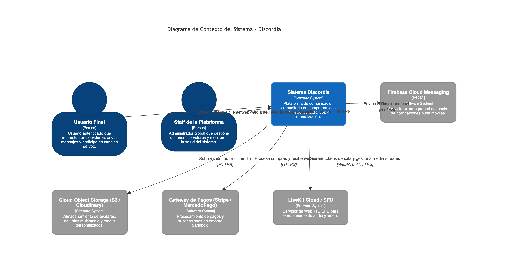
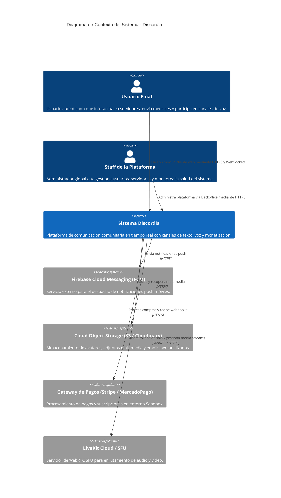
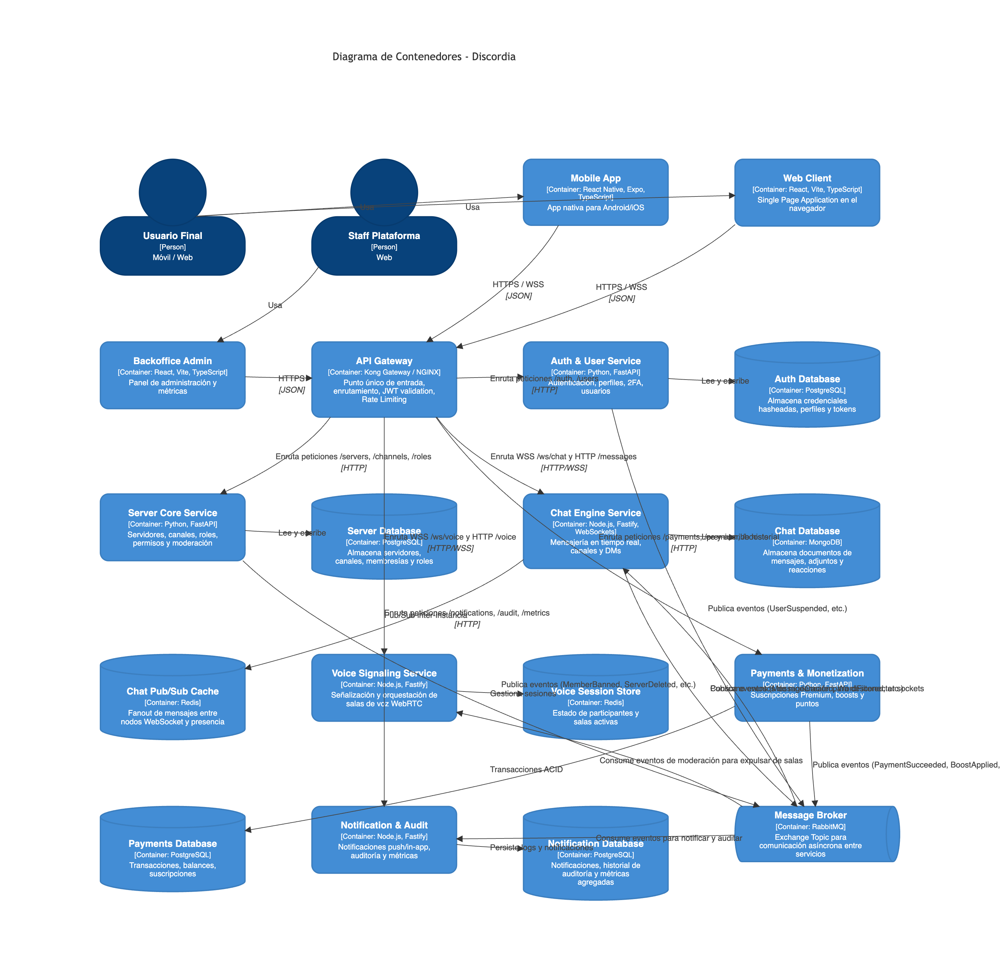

# Arquitectura del Sistema - Discordia (Ingeniería del Software 2)

## 1. Visión General del Sistema y Contexto

**Discordia** es una plataforma distribuida de comunicación en tiempo real inspirada en Discord, orientada a comunidades mediante servidores, canales temáticos de texto y voz, mensajería directa, moderación, roles jerárquicos con permisos granulares, notificaciones push e in-app, monetización (suscripciones Premium y boosts de servidor) y administración global vía Backoffice.

El sistema contempla cuatro superficies clave:
1. **Cliente Web:** Interfaz para usuarios finales desde navegadores de escritorio y móviles (React + Vite + TypeScript).
2. **Aplicación Mobile:** Interfaz nativa para usuarios finales en Android/iOS (React Native + Expo + TypeScript).
3. **Backoffice:** Panel de control de uso exclusivo para el staff global de la plataforma (React + Vite + TypeScript).
4. **Servicios Backend:** Ecosistema desacoplado de microservicios políglotas con persistencia políglota (*Database-per-Service*) y comunicación asíncrona por defecto.

---

## 2. Bounded Contexts y Descomposición en Microservicios (Domain-Driven Design)

Aplicando DDD (*Domain-Driven Design*) y el principio de alta cohesión y bajo acoplamiento, el dominio se divide en 6 microservicios autónomos:

```
+-----------------------------------------------------------------------------------+
|                                  SUPERFICIES CLIENTE                              |
|   [ Mobile App (React Native) ]  [ Web Client (React) ]  [ Backoffice (React) ]   |
+-----------------------------------------------------------------------------------+
                                         │
                                         ▼ (HTTPS / WSS)
+-----------------------------------------------------------------------------------+
|                        API GATEWAY (Kong Gateway / NGINX)                         |
|  - Reverse Proxy y enrutamiento a microservicios                                  |
|  - Autenticación centralizada JWT e inyección de headers (X-User-Id, X-User-Role) |
|  - Rate Limiting (por IP y por usuario autenticado)                               |
|  - Terminación SSL/TLS y políticas CORS                                           |
+-----------------------------------------------------------------------------------+
       │                │                 │                │               │
       ▼                ▼                 ▼                ▼               ▼
┌──────────────┐ ┌──────────────┐ ┌──────────────┐ ┌──────────────┐ ┌──────────────┐
│  Auth & User │ │ Server Core  │ │ Chat Engine  │ │  Voice Core  │ │ Payments &   │
│   Service    │ │   Service    │ │  (Real-Time) │ │ (Signaling)  │ │ Monetization │
│ [Python/Fast]│ │ [Python/Fast]│ │[Node/Fastify]│ │[Node/Fastify]│ │ [Python/Fast]│
│ (PostgreSQL) │ │ (PostgreSQL) │ │ (Mongo+Redis)│ │   (Redis)    │ │ (PostgreSQL) │
└──────────────┘ └──────────────┘ └──────────────┘ └──────────────┘ └──────────────┘
       │                │                 │                │               │
       └────────────────┴────────┬────────┴────────────────┴───────────────┘
                                 ▼
+-----------------------------------------------------------------------------------+
|                     MESSAGE BROKER (RabbitMQ Topic Exchange)                      |
|                     Event-Driven Asynchronous Communication                       |
+-----------------------------------------------------------------------------------+
                                 │
                                 ▼
                     ┌───────────────────────┐
                     │ Notification & Audit  │
                     │       Service         │
                     │   [Node.js/Fastify]   │
                     │     (PostgreSQL)      │
                     └───────────────────────┘
```

### 2.1. Responsabilidades y Persistencia por Servicio

1. **Auth & User Service:**
   - **Responsabilidad:** Registro de usuarios, login con contraseña (Argon2id/BCrypt), autenticación federada (OAuth2/Google), 2FA con TOTP, PIN de recuperación, gestión de perfiles (avatar, biografía, estado personalizado), suspensión/reactivación de usuarios por staff.
   - **Stack & BD:** Python 3.12 (FastAPI, Pydantic, SQLAlchemy Async) + PostgreSQL 16.
   - **Eventos Emitidos:** `UserRegistered`, `UserProfileUpdated`, `UserSuspended`, `UserReactivated`.

2. **Server & Roles Core Service:**
   - **Responsabilidad:** Creación y configuración de servidores, categorías y canales (texto y voz), jerarquía de roles, asignación de permisos, invitaciones, miembros del servidor, moderación (expulsiones, baneos, revocación de baneos, muteos temporales, auditoría de servidor).
   - **Stack & BD:** Python 3.12 (FastAPI, SQLAlchemy Async) + PostgreSQL 16.
   - **Eventos Emitidos:** `ServerCreated`, `ServerDeleted`, `ChannelCreated`, `ChannelDeleted`, `MemberJoined`, `MemberLeft`, `MemberBanned`, `MemberUnbanned`, `MemberMuted`, `RolePermissionsUpdated`.

3. **Chat Engine Service (Real-Time Messaging):**
   - **Responsabilidad:** Conexiones WebSocket para mensajería en tiempo real en canales y DMs, persistencia de mensajes, paginación e historial, reconexión y sincronización de mensajes perdidos, reacciones, menciones, adjuntos, filtro de palabras prohibidas, presencia básica de escritura.
   - **Stack & BD:** Node.js 20 / TypeScript (Fastify + ws/Socket.IO) + MongoDB 7 (historial de mensajes y documentos desnormalizados) + Redis 7 (Pub/Sub para propagación entre réplicas).
   - **Eventos Emitidos:** `MessageCreated`, `MessageEdited`, `MessageDeleted`, `MessageReported`.
   - **Eventos Consumidos:** `MemberBanned`, `MemberMuted`, `ServerDeleted`, `ChannelDeleted` (para desconectar sockets o rechazar emisiones).

4. **Voice Signaling & Session Service:**
   - **Responsabilidad:** Señalización WebRTC para canales de voz y llamadas directas 1-1, emisión de tokens de autenticación para la Selective Forwarding Unit (LiveKit), gestión de estados de presencia (hablando, silenciado, ensordecido, cámara web, screen-share).
   - **Stack & BD:** Node.js 20 / TypeScript (Fastify + LiveKit Server SDK) + Redis 7 (almacén de sesiones efímeras de voz).
   - **Eventos Consumidos:** `MemberBanned`, `MemberMuted` (desconectar al usuario de la sala de voz en tiempo real).

5. **Payments & Monetization Service:**
   - **Responsabilidad:** Gestión de planes Premium, compra de puntos, boosts de servidores, integración con pasarelas de pago (Stripe / MercadoPago Sandbox), recompensas, gestión de transacciones e idempotencia.
   - **Stack & BD:** Python 3.12 (FastAPI, SQLAlchemy Async) + PostgreSQL 16.
   - **Eventos Emitidos:** `PaymentCompleted`, `PaymentFailed`, `ServerBoosted`, `PremiumSubscribed`, `PremiumCancelled`.

6. **Notification, Audit & Metrics Service:**
   - **Responsabilidad:** Despacho de notificaciones in-app y push (Firebase Cloud Messaging - FCM), preferencias de notificación por usuario/canal/servidor, registro centralizado de auditoría para staff, agregación de métricas de uso y salud del sistema para el Backoffice.
   - **Stack & BD:** Node.js 20 / TypeScript (Fastify, Prisma/Kysely) + PostgreSQL 16.
   - **Eventos Consumidos:** `MessageCreated`, `MemberBanned`, `ServerBoosted`, `UserSuspended`, etc. (consumidor de RabbitMQ).

---

## 3. Diagramas de Arquitectura C4 Model

### 3.1. Nivel 1: Diagrama de Contexto del Sistema




### 3.2. Nivel 2: Diagrama de Contenedores

```mermaid
C4Container
    title Diagrama de Contenedores - Discordia

    Person(user, "Usuario Final", "Móvil / Web")
    Person(staff, "Staff Plataforma", "Web")

    Container(mobile_app, "Mobile App", "React Native, Expo, TypeScript", "App nativa para Android/iOS")
    Container(web_client, "Web Client", "React, Vite, TypeScript", "Single Page Application en el navegador")
    Container(backoffice, "Backoffice Admin", "React, Vite, TypeScript", "Panel de administración y métricas")

    Container(api_gateway, "API Gateway", "Kong Gateway / NGINX", "Punto único de entrada, enrutamiento, JWT validation, Rate Limiting")

    Container(auth_svc, "Auth & User Service", "Python, FastAPI", "Autenticación, perfiles, 2FA, usuarios")
    ContainerDb(db_auth, "Auth Database", "PostgreSQL", "Almacena credenciales hasheadas, perfiles y tokens")

    Container(server_svc, "Server Core Service", "Python, FastAPI", "Servidores, canales, roles, permisos y moderación")
    ContainerDb(db_server, "Server Database", "PostgreSQL", "Almacena servidores, canales, membresías y roles")

    Container(chat_svc, "Chat Engine Service", "Node.js, Fastify, WebSockets", "Mensajería en tiempo real, canales y DMs")
    ContainerDb(db_chat, "Chat Database", "MongoDB", "Almacena documentos de mensajes, adjuntos y reacciones")
    ContainerDb(cache_chat, "Chat Pub/Sub Cache", "Redis", "Fanout de mensajes entre nodos WebSocket y presencia")

    Container(voice_svc, "Voice Signaling Service", "Node.js, Fastify", "Señalización y orquestación de salas de voz WebRTC")
    ContainerDb(cache_voice, "Voice Session Store", "Redis", "Estado de participantes y salas activas")

    Container(payment_svc, "Payments & Monetization", "Python, FastAPI", "Suscripciones Premium, boosts y puntos")
    ContainerDb(db_payment, "Payments Database", "PostgreSQL", "Transacciones, balances, suscripciones")

    Container(notif_svc, "Notification & Audit", "Node.js, Fastify", "Notificaciones push/in-app, auditoría y métricas")
    ContainerDb(db_notif, "Notification Database", "PostgreSQL", "Notificaciones, historial de auditoría y métricas agregadas")

    ContainerQueue(broker, "Message Broker", "RabbitMQ", "Exchange Topic para comunicación asíncrona entre servicios")

    Rel(user, mobile_app, "Usa")
    Rel(user, web_client, "Usa")
    Rel(staff, backoffice, "Usa")

    Rel(mobile_app, api_gateway, "HTTPS / WSS", "JSON")
    Rel(web_client, api_gateway, "HTTPS / WSS", "JSON")
    Rel(backoffice, api_gateway, "HTTPS", "JSON")

    Rel(api_gateway, auth_svc, "Enruta peticiones /auth, /users", "HTTP")
    Rel(api_gateway, server_svc, "Enruta peticiones /servers, /channels, /roles", "HTTP")
    Rel(api_gateway, chat_svc, "Enruta WSS /ws/chat y HTTP /messages", "HTTP/WSS")
    Rel(api_gateway, voice_svc, "Enruta WSS /ws/voice y HTTP /voice", "HTTP/WSS")
    Rel(api_gateway, payment_svc, "Enruta peticiones /payments, /premium, /boosts", "HTTP")
    Rel(api_gateway, notif_svc, "Enruta peticiones /notifications, /audit, /metrics", "HTTP")

    Rel(auth_svc, db_auth, "Lee y escribe")
    Rel(server_svc, db_server, "Lee y escribe")
    Rel(chat_svc, db_chat, "Lee y escribe historial")
    Rel(chat_svc, cache_chat, "Pub/Sub inter-instancia")
    Rel(voice_svc, cache_voice, "Gestiona sesiones")
    Rel(payment_svc, db_payment, "Transacciones ACID")
    Rel(notif_svc, db_notif, "Persiste logs y notificaciones")

    Rel(auth_svc, broker, "Publica eventos (UserSuspended, etc.)")
    Rel(server_svc, broker, "Publica eventos (MemberBanned, ServerDeleted, etc.)")
    Rel(chat_svc, broker, "Publica eventos (MessageCreated, WordFiltered, etc.)")
    Rel(payment_svc, broker, "Publica eventos (PaymentSucceeded, BoostApplied, etc.)")
    Rel(broker, notif_svc, "Consume eventos para notificar y auditar")
    Rel(broker, chat_svc, "Consume eventos de moderación para desconectar sockets")
    Rel(broker, voice_svc, "Consume eventos de moderación para expulsar de salas")
```




---

## 4. Patrones de Comunicación y Resiliencia Distribuida

### 4.1. Asincronía por Defecto y Transactional Outbox Pattern
Para evitar la pérdida silenciosa de eventos o estados inconsistentes (*dual-write problem*):
- Cada microservicio que emite eventos implementa el **Transactional Outbox Pattern**: en la misma transacción ACID de base de datos que guarda el cambio de negocio, se inserta una fila en la tabla `outbox_events`.
- Un proceso ligero (Outbox Worker) lee los eventos no procesados, los publica en RabbitMQ con confirmación del broker (*Publisher Confirms*) y los marca como entregados.

### 4.2. Consistencia en Pagos y Monetización: Saga Pattern
- Las operaciones complejas entre servicios (ej. compra de Puntos -> descuento de saldo -> aplicación de Boost al Servidor) se ejecutan mediante una **Saga Orquestada**.
- Si el paso de aplicar el boost falla (ej. servidor eliminado en simultáneo), el orquestador dispara transacciones compensatorias para reembolsar los puntos y notificar al usuario.
- **Idempotencia:** Los endpoints de pagos y webhooks utilizan `Idempotency-Key` para evitar doble procesamiento ante reintentos de red.

### 4.3. Resiliencia en Llamadas Sincrónicas
- Cuando excepcionalmente se utiliza HTTP sincrónico entre servicios (por ejemplo, validación de permisos en tiempo real o login):
  - **Circuit Breaker:** Abre el circuito ante fallas consecutivas para evitar saturación y fallos en cascada.
  - **Exponential Backoff con Jitter:** Reintentos automáticos para errores de red transitorios (HTTP 503, timeouts).

---

## 5. Observabilidad, Monitoreo y Calidad

- **Health Checks Semánticos:**
  - `/livez`: Valida que el proceso esté vivo localmente. No consulta bases de datos ni servicios externos.
  - `/readyz`: Valida dependencias críticas (PostgreSQL, MongoDB, Redis, RabbitMQ). Si una falla, responde 503.
- **Logs Estructurados:** Formato JSON con campos estandarizados (`timestamp`, `level`, `service`, `trace_id`, `user_id`, `message`).
- **Trazabilidad Distribuida:** Encabezado `traceparent` (W3C / OpenTelemetry) propagado a través de Gateway, llamadas HTTP y mensajes en RabbitMQ.
- **Métricas:** Formato Prometheus en `/metrics`, visualizadas en dashboards de Grafana.
- **Testing:**
  - Pirámide completa: Unitarios por servicio, Integración con Testcontainers, Pruebas de Contrato OpenAPI (Schemathesis/Pact).
  - Pruebas de carga y estrés con **k6** (incluyendo escenarios masivos de WebSockets).
  - Mutation Testing con **mutmut** / **Stryker**.
  - SAST en CI con **Bandit**, **ESLint** y **Semgrep**.
